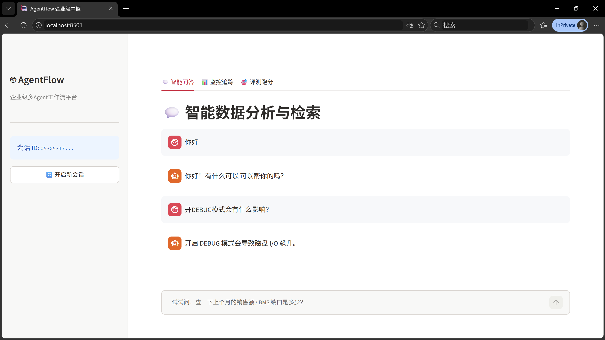
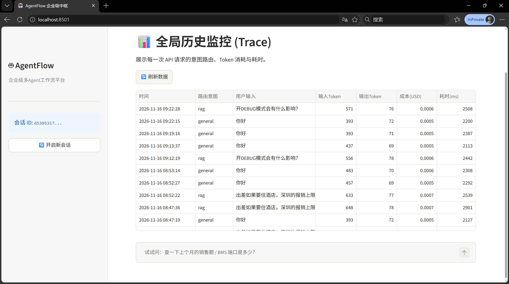

# 🤖 AgentFlow: 企业级多 Agent 工作流与评测平台

<p align="center">
  
  
  
  
</p>

## 📖 项目简介
AgentFlow 是一个基于 **LangGraph、FastAPI、Streamlit** 构建的轻量级多 Agent 工作流与 RAG 评测平台。系统针对新能源车企的真实业务场景（如 BMS 协议查询、财务报销规定），实现了意图精准路由、混合检索、失败重试与全链路可观测性。

## 🖼️ 效果展示

### 🎬 系统演示 (GIF)


### 💬 智能问答


### 📊 监控追踪


## ✨ 核心特性

- **🧠 多 Agent 智能路由 (Supervisor)**：
  基于 LangGraph 构建 Supervisor 状态机。根据用户意图，自动分发至 `DB 查询 (NL2SQL)`、`知识库检索 (RAG)` 或 `通用问答`。使用 Pydantic 严格约束结构化输出。
- **🔍 企业级混合检索 (Hybrid RAG)**：
  彻底解决专有名词召回不准的痛点。引入 `jieba` 分词 + `BM25` 算法，结合 Chroma 向量检索进行 `RRF` (倒数排名融合)，并接入云端 `qwen3-rerank` 进行二次重排。
- **📊 无侵入式全链路监控**：
  基于 LangChain `AsyncCallbackHandler`，在不侵入业务代码的前提下，全局捕获 LLM 的 Token 消耗与成本（USD），并推送到 Prometheus。
- **🐳 一键容器化交付**：
  采用 Docker 多阶段构建（非 root 用户），通过 Docker Compose 一键编排 App、UI、Postgres、Prometheus、Grafana 五大微服务。

## 🚀 快速启动

1. 克隆项目并配置环境变量：
   ```bash
   git clone https://github.com/你的GitHub用户名/agentflow.git
   cd agentflow
   cp .env.example .env
   # 填入你的 LLM_API_KEY 和 DASHSCOPE_API_KEY
   
## 📝 踩坑与架构思考 (博客)
- [大模型应用踩坑实录：Streamlit 局部状态污染与 Docker 挂载的连环局](https://juejin.cn/post/7708586194205196315)